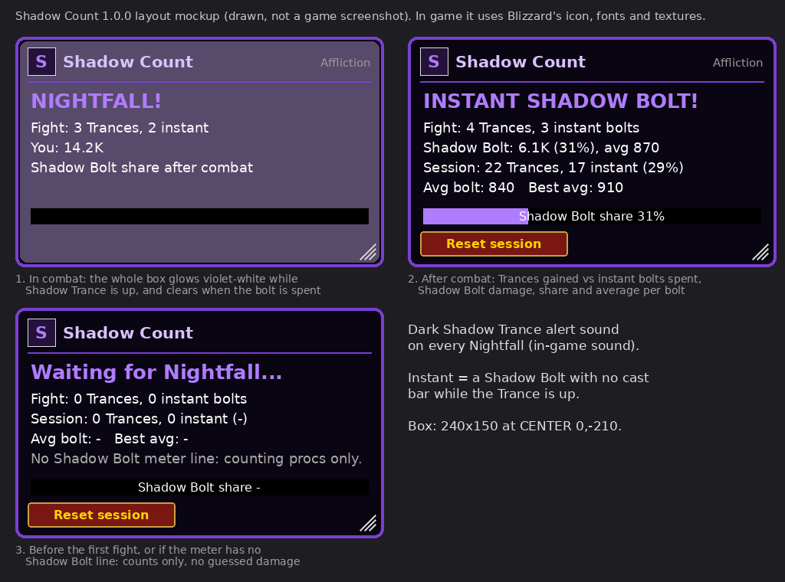

# Shadow Count (WoW: Forever) v1.0.0

  

A Nightfall counter for Warlocks. A small shadow-purple box glows and shows **NIGHTFALL!** while Shadow Trance is up, and counts how many Trances you got and how many you spent on an instant Shadow Bolt. When the fight ends it shows Shadow Bolt's damage, its share of your damage and the average per bolt, taken from the game's own damage meter.

## What it shows
- **While Shadow Trance is up:** `NIGHTFALL!` and a violet-white glow over the whole box. It clears when you spend it (`INSTANT SHADOW BOLT!`) or when the Trance runs out.
- **This fight:** Trances gained and instant Shadow Bolts spent; after combat, Shadow Bolt damage, share and average per bolt.
- **This session:** Trances, instant bolts, Shadow Bolt share, average per bolt and your best fight average. The **Reset session** button starts a new session (it hides during combat).
- **Share bar:** Shadow Bolt's share of your damage.

## Where the numbers come from
WoW: Forever runs on the modern client, which gives addons **no combat log**, and every single hit's damage reaches addons as a hidden ("secret") value. Shadow Count never guesses a number:
- **Trances** are exact: Shadow Trance is its own game spell (17941), and the game tells addons when you gain it.
- **Instant bolts:** a Shadow Bolt that goes off while the Trance is up with no cast bar. A bolt you were already casting when the Trance landed does not count.
- **Damage** comes from **Blizzard's built-in damage meter**, worked out once combat ends (all Shadow Bolt ranks together).
- If the meter has no Shadow Bolt line, the box says **"counting procs only"**. `/shc meter` lists the meter's lines for your last fight.
- No live per-hit numbers and no "biggest bolt": the game does not give single hits to addons.

Turn on the game's meter if the box shows no damage: **Options > Gameplay > Advanced > Damage Meter > Enable Damage Meter**.

## Sound
`/shc sound every` (default): the game's own dark Shadow Trance alert on every Nightfall. `/shc sound record`: when a fight beats your best average per bolt. `/shc sound off`.
`/shc soundfile theme|trance|shadow|curse` picks the sound and plays it once. All sounds are built into the game.

## Download
- **CurseForge:** https://www.curseforge.com/wow/addons/shadowcount. Author: [MasterRed92](https://www.curseforge.com/members/masterred92/projects).
- **Wago Addons:** https://addons.wago.io/addons/shadowcount.
- **GitHub:** [Releases](https://github.com/masterred92/ShadowCount/releases) · [Issues](https://github.com/masterred92/ShadowCount/issues)
- **More by Kenny:** [GaleCount](https://github.com/masterred92/GaleCount) · [ReckoningCheckoning](https://github.com/masterred92/ReckoningCheckoning) · [BeastMode](https://github.com/masterred92/BeastMode) · [GoldPerSpot](https://github.com/masterred92/GoldPerSpot) · [MatTooltip](https://github.com/masterred92/MatTooltip) · [PriceLog](https://github.com/masterred92/PriceLog) · [NeutralFlip](https://github.com/masterred92/NeutralFlip)

## Commands
Main command `/shc`; `/shadowcount` works too.
`/shc show` / `hide` · `lock` / `unlock` · `resetpos` · `scale 0.5-2` · `size <width> <height>` · `reset` (session) · `test` (preview out of combat) · `sound …` · `soundfile …` · `theme` (re-check your talents) · `meter` · `debug` · `report`

The box only appears on a Warlock. Move it by dragging; resize it with the corner grip. Both stop working while it is locked.

## Install
1. Download the zip, or clone this repo into a folder named `ShadowCount`.
2. Put the `ShadowCount` folder in `World of Warcraft\_forever_\Interface\AddOns\` (the folder next to `_retail_`; the exact name may differ).
3. Restart the game or type `/reload`, and check Shadow Count is ticked in the AddOns list.

## In-game test checklist
1. On a Warlock, the box appears below the middle of the screen, can be dragged and resized, and keeps its place after `/reload`. On other classes it stays hidden.
2. With Nightfall talented, put Corruption or Drain Life on a mob: when Shadow Trance procs, the box glows, shows `NIGHTFALL!` and plays the alert.
3. Cast Shadow Bolt during the Trance: `INSTANT SHADOW BOLT!`, the glow clears and the instant count goes up. Let one run out: the glow clears without counting.
4. After the fight: Shadow Bolt damage, share and average appear, or "counting procs only". `/shc meter` lists the meter lines.
5. **Reset session** sets the session line back to 0 and is hidden in combat.
6. No Lua errors and no "action blocked" messages during combat.

## Licence
MIT. Written from scratch; no code copied from other addons.
